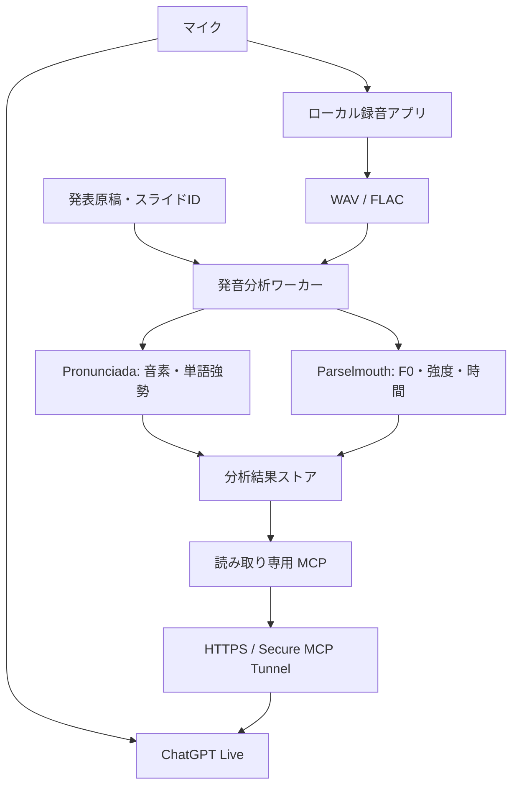

# ChatGPT Live × ローカル発音評価 MCP 設計書

> 初期の設計書（v0.1）。実装では Parselmouth を使わず Pronunciada のピッチ推定に一本化し、図はアプリの分析画面で見る形にした（ChatGPT 連携は任意）。現在の仕様は README と docs/ を参照。

2026-11-24 / v0.1（調査・設計段階、接続実証前）

## 1. 目的

ChatGPT Live の既存音声会話を維持し、発表練習中のマイク入力を別プロセスで録音する。終了後に専門エンジンで音素・単語内強勢・韻律を評価し、ChatGPT に構造化結果を取得させ、口頭で改善点を説明させる。日本語訛りの除去ではなく、国際学会での明瞭性を優先する。文字起こしの正しさを発音の正しさと同一視しない。

## 2. 接続可否の調査結果

OpenAI の現行公式資料では Live は利用可能なプラグイン・接続済みアプリを呼び出せる。また ChatGPT の Web 版は公開 HTTPS の MCP エンドポイント、または Secure MCP Tunnel を介した私設サーバーを登録できる。Pro については read/fetch 権限でのカスタム MCP 接続が記載され、フル MCP の書き込み機能は Business / Enterprise / Edu に限定されている。個別アカウントの権限は未確認。公式資料を組み合わせると読み取り型プラグインを Live で利用する設計は有望だが、当該アカウントでの自作 MCP 呼び出しは未実証。音声ストリームを直接 MCP に渡す公開仕様も確認できていない。

| 項目 | 判定 |
|---|---|
| Live からプラグイン利用 | 公式に対応 |
| Web から自作リモート MCP 登録 | 対応、権限による |
| Pro の read/fetch | 公式に対応、個別契約は要確認 |
| 録音開始・停止のリモート操作 | 書き込み権限が必要になり得るため MVP では使わない |
| Live から自作 MCP の実呼び出し | 未実証 |
| Live の生音声を MCP に受け渡す | 公開仕様未確認、設計上不要 |

## 3. 推奨アーキテクチャ



録音アプリが終了を検知して分析を開始する。Live は解析済み結果を読むだけにする。MCP に録音ファイルを送信する必要はなく、ローカルパスもクラウド側に公開しない。

## 4. 利用フロー

1. ローカルアプリで原稿とスライドを選択し、録音開始（ホットキーまたはボタン）。
2. ChatGPT Live に発表を最後まで遮らないよう依頼して発表する。
3. ホットキーで録音終了。将来的に VAD による終了候補検知を追加するが、発表中の間を終了と誤認しないよう明示操作を優先する。
4. ローカルで分析し、結果をストアに保存する。
5. Live に「最新の発音分析を確認して」と依頼し、MCP から取得する。
6. 音声で指摘を返す。重要度順に単語・実測根拠・推奨発音・再練習方法を説明する。

## 5. 実装候補

- Linux: Python + sounddevice（PortAudio）または PipeWire 対応録音。ブラウザと同時に同じマイクを使えるかテスト。録音はマイクのみとし、スピーカー出力の混入を避けるためイヤホンを利用。
- 保存: 元音声 WAV/FLAC（モノラル PCM、例 48 kHz）。分析側で必要なサンプルレートに変換。MP3 は共有用のみ。
- Pronunciada: Apache-2.0 のローカル評価ライブラリ。公式 README に英語の word stress、音素・単語スコア、タイムスタンプ、誤り候補が記載される。標準 MCP は stdio の `assess_pronunciation(audio_path, reference_text, language)`。今回は同じホストで Python API を呼ぶ方が単純。モデル初回取得が必要。長い発表は文・短い区間に分割して評価し、性能を実測する。
- Parselmouth/Praat: F0、相対強度、持続時間等を計測。Pronunciada のタイムスタンプまたは別途強制アライメントを利用。音節区間・母音核を対応付け、発話内で正規化する。ピッチだけで強勢を断定しない。
- MCP: Python MCP SDK/FastMCP で読み取り型ツールを公開。Streamable HTTP の `/mcp` または Secure MCP Tunnel。SQLite とファイルで結果を保持。

Pronunciada の公開ベンチマークは作者による評価であり、英語文レベルの韻律では Azure が上回る指標もある。日本語母語話者の学会発表や固有名詞、略語・頭字語について精度を別途検証する。

## 6. MCP 契約案（自作ツール）

| ツール | 引数 | 動作 |
|---|---|---|
| `get_latest_analysis` | `session_id`（任意） | 最新の完了済み分析と録音状態を取得 |
| `get_analysis` | `recording_id` | 指定録音の分析詳細を取得 |
| `list_analyses` | `session_id`, `limit` | 過去の練習一覧を取得 |
| `get_word_detail` | `recording_id`, `word_index` | 単語・音素・音節の分析を取得 |

すべて副作用なし、`readOnlyHint: true`。録音開始・停止・削除はローカル UI が担当。分析未完了の場合は `pending` を返し、古い録音を最新と偽らない。将来的な制御ツールは書き込み権限が確認できた環境のみで別途実装する。

### 結果 JSON（架空の例、実測ではない）

```json
{
  "recording_id": "cover-003",
  "slide_id": "cover",
  "status": "completed",
  "reference_revision": "v3",
  "words": [{
    "word": "development",
    "start_ms": 22300,
    "end_ms": 23000,
    "expected_ipa": "dɪˈveləpmənt",
    "expected_stress_syllable": 2,
    "estimated_stress_syllable": null,
    "stress_confidence": null,
    "phones": [],
    "syllables": [],
    "warnings": ["stress not reliably determined"]
  }],
  "engine_versions": {},
  "warnings": []
}
```

音素については期待 IPA と認識された候補を分離する。強勢は推定位置・確信度・音節の F0/強度/長さを分ける。算出不能な値は null とし、辞書の標準発音を実測として扱わない。上記は自作側の正規化スキーマ案であり Pronunciada の実際の出力仕様ではない。

## 7. 接続検証（最初に実施）

1. 最小 MCP を実装し、読み取り専用 `get_latest_analysis` が固定のテスト ID と時刻を返すようにする。
2. Web の Plugins → ＋ → Add custom MCP server で HTTPS URL または Tunnel を登録する。項目がなければ権限を確認する。
3. 通常のテキストチャットで呼び出し、サーバーログと返却値を照合する。
4. 同じプラグインを利用できる Live 会話で「最新の分析 ID を教えて」と発話する。ログに新規呼び出しがあり、その結果が音声応答に反映された場合のみ成功とする。
5. Live で不可なら通常チャットで取得して会話に結果を持ち込む。必要なら独自の Realtime API クライアントを検討する（別途 API 課金、実装が必要）。
6. 接続成功後、固定テスト値を実際の録音分析結果に差し替える。

## 8. セキュリティ・評価

- HTTPS/OAuth または利用可能な Secure MCP Tunnel を選択。認証なしの Pronunciada HTTP サーバーを直接公開しない。
- 録音開始を明示し、録音状態を表示。ローカル削除と保存期間を設定する。外部に送るのは原則として分析結果のみ。
- 別セッションの誤取得、同時録音、途中失敗、無音、クリッピング、原稿違いをテストする。
- 同一単語の正しい強勢と意図的にずらした強勢を録音し、評価器が区別できるか確認する。人間による聴取と照合する。
- 合格条件: 音声会話中の読み取り呼び出し、録音との ID 一致、単語別根拠の取得、確信度の低い誤りを断定しないこと。

## 9. 実装順序

- Phase 0: 固定 JSON を返す MCP と Live 接続の実証。
- Phase 1: ローカル録音・原稿選択・Pronunciada 評価・結果保存。
- Phase 2: Parselmouth による強勢・韻律補助、フィードバックの改善。
- Phase 3: VAD、複数回の比較、Hermes 等の別ハーネス連携、Android クライアント（必要に応じて）。

## 10. 参考資料

確認日: 2026-11-24。

- OpenAI, ChatGPT Voice: https://help.openai.com/en/articles/20001274-chatgpt-voice
- OpenAI, Connecting custom MCP servers in ChatGPT: https://help.openai.com/en/articles/12584461-connecting-custom-mcp-servers-in-chatgpt
- OpenAI, Connect and test your plugin: https://developers.openai.com/plugins/deploy/connect-chatgpt
- OpenAI, Secure MCP Tunnel: https://developers.openai.com/api/docs/guides/secure-mcp-tunnels
- OpenAI, Authentication: https://developers.openai.com/plugins/build/auth
- Pronunciada repository (機能・API・ベンチマーク): https://github.com/moglearn/pronunciada
- Parselmouth: https://github.com/YannickJadoul/Parselmouth

